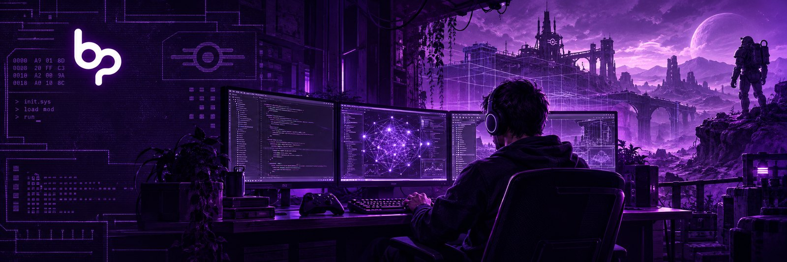
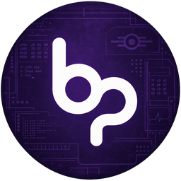
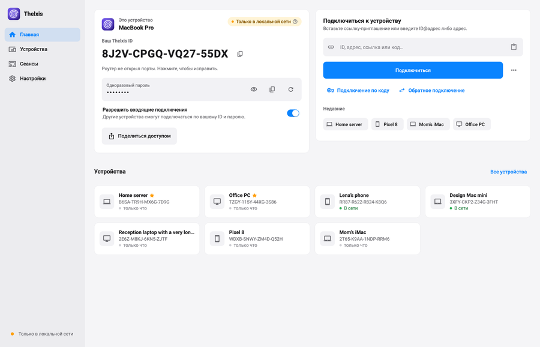
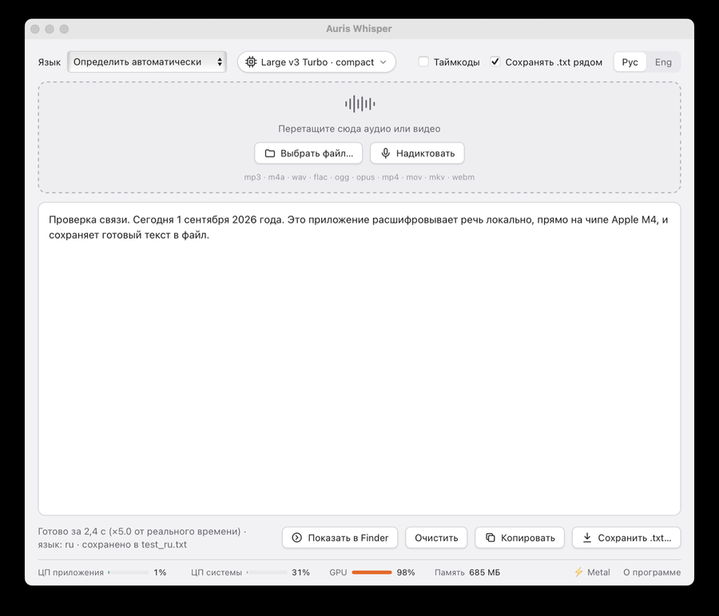
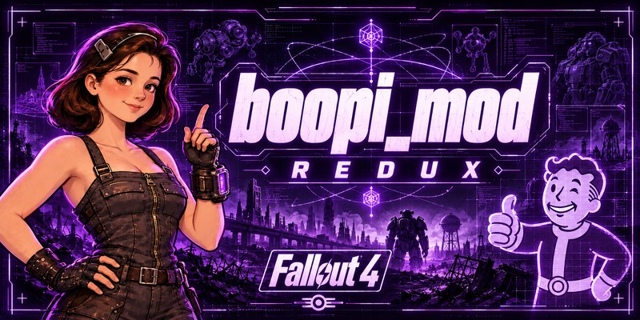
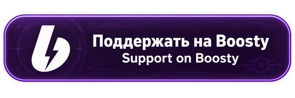

  

# boopi_coder

**Программы, моды для игр и ИИ-решения — без облаков, на вашем компьютере.** 
*Software, game mods and AI solutions — no clouds, on your own computer.*

 

Омск · Omsk, Russia

 

## Главное · Featured

<table>
<tr>
<td width="50%" valign="top">

<h3>&nbsp;<a href="https://github.com/boopi-coder/thelxis">Thelxis</a></h3>

**Удалённый рабочий стол без серверов и аккаунтов.** Сквозное шифрование, связь «компьютер — компьютер» напрямую по WebRTC — картинка не зависает. Передача файлов и буфер обмена, подключение по коду даже через NAT оператора, обязательный индикатор «вы подключены» на экране и подписанные OTA-обновления. 
*Serverless, end-to-end encrypted remote desktop. PC-to-PC over WebRTC, no servers, no accounts. File transfer and clipboard, connect-by-code through carrier NAT, a mandatory on-screen “connected” badge and signed OTA updates.*

  

</td>
<td width="50%" valign="top">

<h3>&nbsp;<a href="https://github.com/boopi-coder/auris-whisper">Auris Whisper</a></h3>

**Офлайн-расшифровка речи.** Перетащите файл или надиктуйте — получите чистый `.txt`. Русские модели GigaAM v3 и T-One, Whisper для ~30 языков, разделение по говорящим, ускорение на GPU (Metal / Vulkan) и автообновления. Ничего не уходит с компьютера. 
*Offline speech-to-text. Drop a file or dictate and get a clean `.txt`. Russian GigaAM v3 / T-One models, Whisper for ~30 languages, speaker separation, GPU acceleration (Metal / Vulkan), auto-updates. Nothing leaves your computer.*

  

</td>
</tr>
</table>

 

## Ещё проекты · More projects

| Проект · Project | О чём · About |
|:--|:--|
| **[Daz Remote Bridge](https://github.com/boopi-coder/daz-remote-bridge)** | Плагин для Daz Studio 6: HTTP/JSON-сервер внутри программы, который выполняет DAZ Script — сценой можно управлять снаружи, из скрипта или ИИ-агента. *A Daz Studio 6 plugin: an HTTP/JSON server inside the app that evaluates DAZ Script, so the scene can be driven from outside.* |
| **[DazToUnreal · macOS](https://github.com/boopi-coder/DazToUnreal)** | Форк моста Daz → Unreal: апстрим собирает плагин только под Windows, здесь он собирается и работает на macOS. Готовый `.dylib` — в релизах. *A fork of the Daz → Unreal bridge that builds and runs the Daz Studio 6 plugin on macOS. Prebuilt `.dylib` in Releases.* |

 

## Моды для игр · Game mods

**boopi_mod REDUX** для Fallout 4, а также моды для Skyrim, Starfield, Cyberpunk 2077 и The Sims 4. Новые релизы — на [Boosty](https://boosty.to/boopi_coder). 
*boopi_mod REDUX for Fallout 4, plus mods for Skyrim, Starfield, Cyberpunk 2077 and The Sims 4. New releases on [Boosty](https://boosty.to/boopi_coder).*

 

## Для бизнеса · For business

Разрабатываю программы под задачу — от идеи до готового продукта, с упором на локальную работу и приватность данных. 
*I build software to fit the task — from idea to a finished product, with a focus on local operation and data privacy.*

- **Программы на заказ** · *custom software*
- **Автоматизация бизнес-процессов** · *process automation*
- **Внедрение ИИ** — локальные модели, ассистенты, боты · *AI integration: local models, assistants, bots*
- **Десктоп- и мобильные приложения** · *desktop and mobile apps*
- **Моды для игр на заказ** · *custom game mods*

 

## Стек · Stack

 

## Поддержать · Support

Подписка помогает развивать текущие проекты и запускать новые. Уровни — от 300 ₽. 
*Your subscription keeps current projects moving and helps launch new ones. Tiers start at 300 ₽.*

Спасибо, что заглянули. · *Thanks for stopping by.*

